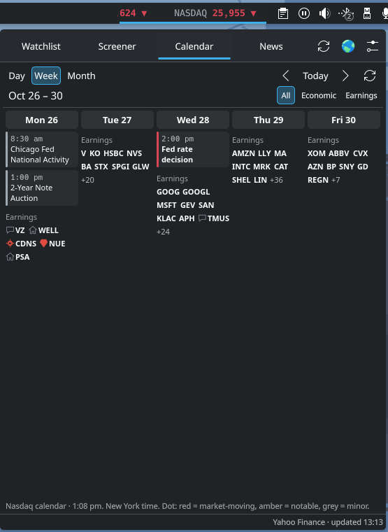
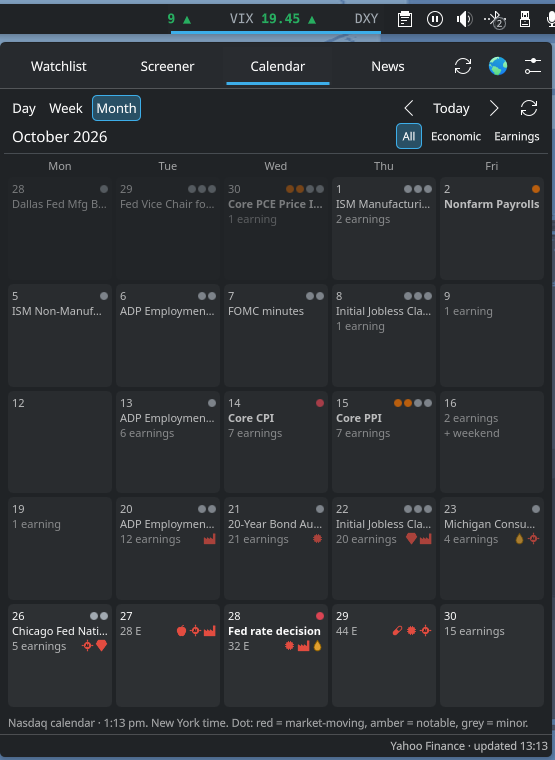
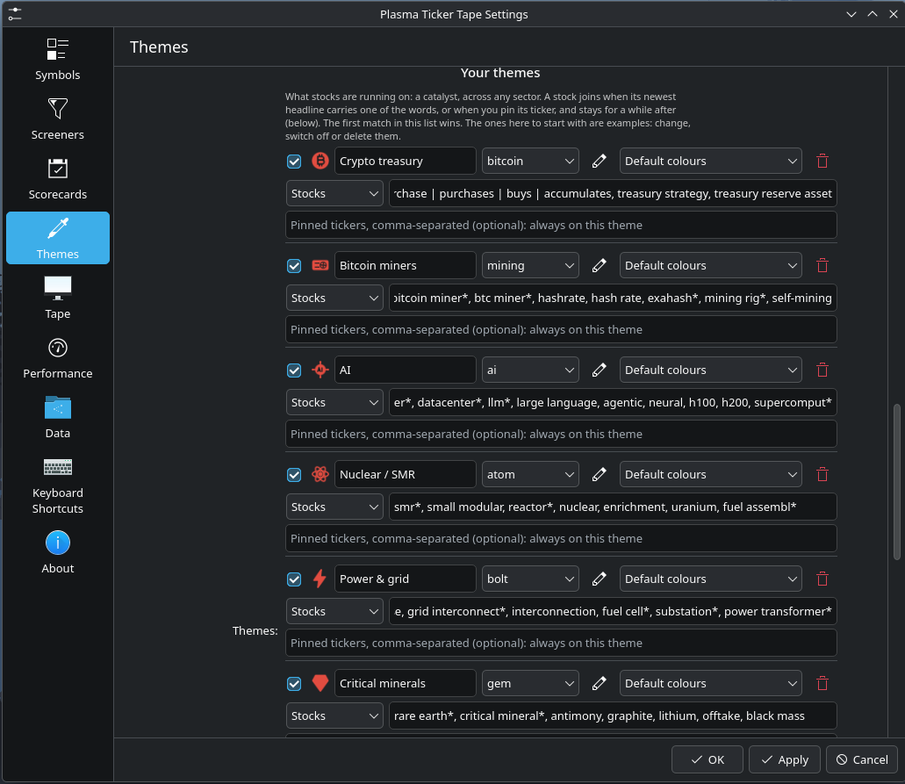
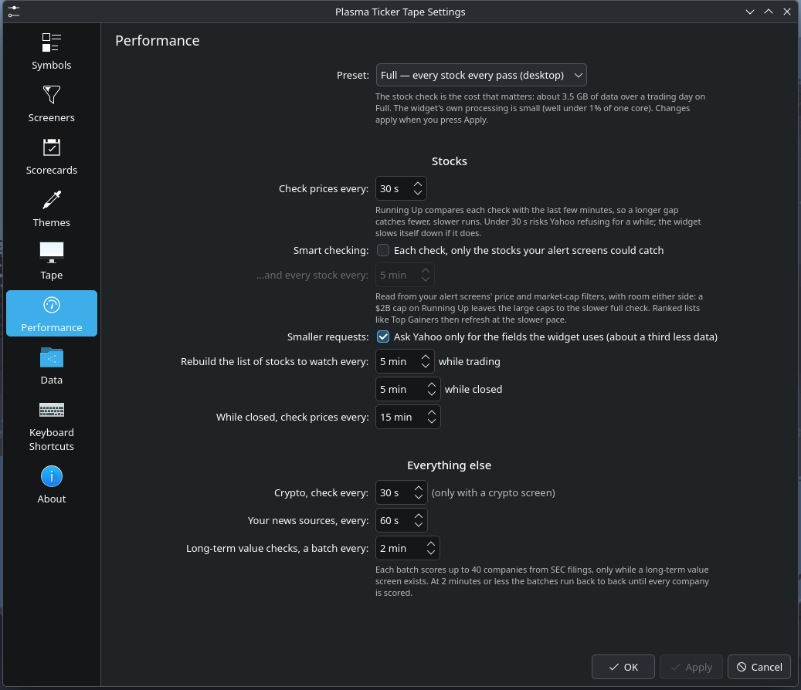

# Plasma Ticker Tape

A market ticker tape for the KDE Plasma 6 panel, with a full trading pop-up behind it: a watchlist, live market screeners with alerts and scorecards, candlestick charts with drawing tools, an economic and earnings calendar, and market news.


*On the panel at its default width and speed. [Watch it as video (MP4)](docs/screenshots/tape.mp4).*

**▶ [Watch the 2-minute demo](docs/demo.mp4)** — every tab, the detail view and the settings.

No account, no API key, no telemetry. Everything runs on your machine.

---

## What it does

### The tape

A scrolling strip on your panel: each symbol's price and a green ▲ or red ▼ for the day. **VIX turns red** at your fear line (20 by default). Hover pauses it and shows the full figures. Left-click opens the pop-up. Middle-click opens Yahoo Markets.


*Click the tape and the pop-up drops down from the panel. [Watch it as video (MP4)](docs/screenshots/popup.mp4).*

### Watchlist

Stocks, indices, ETFs, crypto, currencies and futures. Each has its price, the day's change and range, and an intraday sparkline. Star the ones you want on the tape.

**Look up any symbol** with the box at the top of the tab: type it and press Enter, and its card opens without joining your watchlist. Use Yahoo's symbols, such as `AIRE`, `^GSPC` or `BTC-USD`. A plain coin symbol such as `BTC` opens the coin when one exists.


### Screener

Several thousand actively traded US stocks, checked every 30 seconds by default. Five starting screens, all editable, and you can add your own:

| Screen | What it finds |
|---|---|
| **Running Up** | A stock up 3%+ off its low of the last 2 minutes, at a new high for that window |
| **High of Day** | A stock breaking the session's high |
| **Top Gainers / Top Losers** | The day's biggest movers, live |
| **Deep Value Recovery** | Companies worth $2B+ passing 6 or more of 8 long-term fundamental checks, price to free cash flow among them, at least 15% below their 52-week high and back above their 50-day average |

Each alert row carries float, short interest, relative volume, a **dilution rating** from SEC filings and a **scorecard**: your rules, scored live, with what was missed. Each screen can have its own alert sound.


### Detail view

Click any symbol anywhere to get:
- **A chart.** Line or candles, 1D to 5Y, plus intraday 1m / 5m / 15m / 30m / 1h bars with premarket and after hours, VWAP and a volume strip.
- **Zoom and pan.** The scroll wheel zooms, dragging pans, and the price scale stretches.
- **Drawing tools.** Double-click for a price level, or use the Line button for trend lines. Both are saved per symbol.
- **A short description** of the company (Yahoo's company profile), or of the coin (CoinGecko). Click it to read all of it.
- **Figures.** The full quote, float and short interest, and the dilution line.
- **Filings.** The globe button opens the stock's filings on [BamSEC](https://www.bamsec.com/), where shelf registrations and offerings show first. Crypto and index buttons open Yahoo's quote page.
- **The 8 long-term checks.** 5-year P/E, ROIC, share count, FCF / earnings / revenue growth, long-term liabilities to FCF, and price to FCF.
- **News** for that company.

| Chart and scorecard | Long-term checks and quote | Company news |
|---|---|---|
|  |  |  |

### Calendar and News

The week's market-moving economic releases (CPI, jobs, Fed, PMI and more) with expected, previous and actual figures. Earnings come with EPS estimates for **the companies you choose** (see [Settings → Data](#data)). The News tab carries the market desks plus headlines for every stock on your screens.

- **Calendar: Day, Week or Month.** Day lists the releases in time order with a *now* line through today, then the reporters before the open and after the close. Week puts Monday to Friday side by side, with a weekend day added when it has releases. Month is a grid of weekdays with importance dots, the day's biggest release and how many report; click a day to open it.
- **Read the release.** An economic release links to its publisher's page (Federal Reserve, BLS, BEA, Census Bureau and others). An earnings report that has printed links to its press release on SEC EDGAR (needs the SEC contact).
- **News as cards.** Each headline has a picture (the feed's own, else the article's preview image), the stocks it names as chips, and its source and age. The same story from two places shows once. Filter by *Your screens*, *Market* or *Your feeds*.
- **Company search.** Type a ticker or a company name ("adobe") in the News search box and that company's own news is listed too.

### New in 1.2 (beta)

- **Themes and sectors (beta).** Each stock is matched to a theme, the tradeable story behind it (one of yours, by its newest headline's words or a ticker you pin), or else to its sector. Each is scored hot, building, quiet or burnt from what its members actually did. Set them up in **Settings → Themes**; right-click a screener row to make a theme from its headline, pin the ticker to one, or set its sector. **How they work, how to write headline words and how to read the heat is in [docs/themes.md](docs/themes.md).**
- **The Theme column.** One column on the screener: the theme's glyph when the stock has one, else its sector's, coloured by how hot it is. Hover it for why. Sort it to put the hottest first.
- **Theme Hunter (beta).** A screen of its own: hot themes, hot sectors, and the runners no theme claims yet: runners under a heating sector that share a headline are the next theme to define.
- **Crypto screens.** Crypto Running Up, Crypto 24h High and Crypto Gainers watch Coinbase pairs around the clock. Add them from **Settings → Screeners**.
- **Currencies.** Any screen can show its figures in US dollars, euros, pounds, yen, Canadian or Australian dollars, Swiss francs, bitcoin or ether.
- **Performance presets.** **Settings → Performance**: *Full* (every stock every pass, for a desktop), *Balanced*, or *Light* (a laptop or a metered connection), or set each control yourself.
- **Scorecards know themes.** A scorecard rule can test the row's theme or sector: its heat, how many members it has today, how many ran.

| Calendar: day | Calendar: week | Calendar: month |
|---|---|---|
|  |  |  |

| News |
|---|
|  |

---

## Install

**You need:**
- KDE Plasma 6. Developed and tested on Plasma 6.8 with Qt 6.12 (Arch Linux); earlier 6.x releases have not been tested yet, so reports either way are welcome.
- Python 3, for the scanner features: float, short interest, per-stock news, the dilution rating, the calendar and the long-term value lists. Standard library only, nothing to `pip install`. Without it, prices, alerts, charts, crypto and your own news sources still work, and the screener says what is missing.
- For alert sounds, any one of `pw-play` (PipeWire), `paplay` (PulseAudio), `canberra-gtk-play` or `ffplay`, picked automatically, or your own player command in Settings → Screeners. Optional.

```bash
git clone https://github.com/wolfe86/plasma-ticker-tape.git
cd plasma-ticker-tape
kpackagetool6 --type Plasma/Applet --install package
```

Then right-click the panel → **Add Widgets** → search **Plasma Ticker Tape** → drag it onto the panel.

**Update** after a `git pull`:

```bash
kpackagetool6 --type Plasma/Applet --upgrade package
kquitapp6 plasmashell && kstart plasmashell
```

The second line restarts the panel so it loads the new version.

**Remove:**

```bash
kpackagetool6 --type Plasma/Applet --remove org.wolfe.marketticker
```

### First run

| When | What happens |
|---|---|
| At once | The tape scrolls the starting symbols |
| ~30 s | The screener's stock pool is built and the first check runs |
| ~1 min | Top Gainers and Top Losers fill |
| ~1 min | The calendar loads |
| Tens of minutes | Deep Value Recovery checks the companies worth $2B or more in batches. The first full pass takes as long as the SEC takes to answer, so the list fills in gradually |

---

## Settings

Right-click the tape → **Configure Plasma Ticker Tape…**

| Page | What you set |
|---|---|
| **Symbols** | Your watchlist. Search to add, ★ to put on the tape, drag to reorder |
| **Screeners** | The stock pool, and every screen: type, trigger, filters, scorecard and sound |
| **Scorecards** | Named rule sets, for example *price $2–$20, up 10%+, relative volume 5×+, float under 20M, news today* |
| **Themes** (beta) | Your themes and sectors: their words, pinned tickers and icons, and how heat is scored. See [docs/themes.md](docs/themes.md) |
| **Tape** | Scroll speed, width, refresh rate, the VIX fear line |
| **Performance** | How often the widget asks for data, and how much: Full, Balanced, Light or Custom |
| **Data** | Where the data comes from, and which earnings you care about (below) |

| Symbols | Screeners | Scorecards |
|---|---|---|
|  |  |  |

| Tape | About |
|---|---|
|  |  |

| Themes (beta) | Performance |
|---|---|
|  |  |

The theme settings are explained in the [themes guide](docs/themes.md).

### Data


| Setting | What it does |
|---|---|
| **Scanner folder** | Leave empty to use the scanner that ships with the widget. To change how lists, news and the calendar are gathered, copy `package/contents/code/scanner/` anywhere, edit it, and point this at your copy |
| **SEC contact** | Your name and email, for example `Jane Doe jane@example.com`. SEC EDGAR requires every program to identify itself ([SEC fair access](https://www.sec.gov/os/accessing-edgar-data)). It is sent **only to sec.gov**. Leave it empty and the dilution rating and the 8 long-term checks stay off |
| **Always list companies worth** | Every company at least this big shows on the earnings calendar. Default $40B |
| **Research folder** | Optional. Any subfolder named by a ticker (1 to 5 letters), in this folder or one level down, puts that company on the calendar. For example `Research/AMD` or `Research/Investing/AMD`. Handy if you keep notes per stock |
| **Always list these tickers** | Optional. Tickers you always want to see, separated by spaces or commas |

**Which earnings show up is up to you.** Every reporter that matches none of these three is left off, so the calendar shows the companies you follow instead of the hundreds that report each week. Set the floor to $0 to see every reporter.

---

## Where the data comes from

| Data | Source |
|---|---|
| Stock prices, charts, quotes, the screener's stock pool, index and ETF figures | Yahoo Finance (unofficial endpoints) |
| Company descriptions on stock cards | Yahoo Finance (company profile) |
| Crypto prices, crypto screens | Coinbase's public exchange data |
| Crypto coins Coinbase does not list, such as Monero | Yahoo Finance (`-USD` pairs) |
| Crypto categories (themes), coin descriptions and coin lookups | CoinGecko's public API (free tier, rate-limited) |
| Premarket and after-hours gainers | stockanalysis.com |
| Float, short interest, relative volume, per-stock headlines | Finviz |
| Dilution (shelves, offerings) and the 8 fundamental checks | SEC EDGAR |
| Economic and earnings calendar | Nasdaq's public calendar |
| Market news | Seeking Alpha, MarketWatch and CNBC RSS feeds |
| Company names for news ranking | CNBC quotes |
| News for non-stock symbols | Google News RSS |
| Filings link on a stock card | [BamSEC](https://www.bamsec.com/) (opens in your browser; nothing is fetched from it) |

> [!WARNING]
> **Not every source is official.** SEC EDGAR, Coinbase and CoinGecko publish APIs for this kind of data. Yahoo Finance, Finviz, stockanalysis.com, Nasdaq's calendar, the news feeds and Google News do not offer a documented public API for it, so they can change or stop answering without notice, and a screen or column will go empty until the scanner is updated. Quotes may be delayed. Check each site's terms for your own use. This project is not affiliated with any of them.

> [!CAUTION]
> **Not investment advice.** This is a tool for watching the market. Its screens, scores and ratings are mechanical filters, not recommendations.

---

## Privacy and security

- **Nothing is sent anywhere except the data sources above**, and the links you click on a card (BamSEC, Yahoo), which open in your browser. No telemetry, no accounts.
- **Your settings stay local.** They live in Plasma's config (`~/.config/plasma-org.kde.plasma.desktop-appletsrc`). The day's alerts, fundamentals results and your chart lines are kept in Qt's local database under `~/.local/share/plasmashell/QML/OfflineStorage/`. Downloads are cached in `~/.cache/market-ticker/`, capped at 200 MB.
- **The scanner runs as you.** The widget runs `python3` on the scanner folder you choose, so only point it at code you trust.
- **Settings reach the scanner through a private file**, readable only by you, and never appear on a command line. Symbols are quoted when a scanner command is built, and the scanner accepts only ticker-shaped arguments.
- **Links from news feeds open only if they are web addresses** (`http://` or `https://`).
- **Your own news feeds** (Settings → Data) can send a header you type, which is saved in plain text in Plasma's config file. Use feeds you trust.

---

## How it is built

```
CHANGELOG.md                   what changed in each version
package/
├── metadata.json              the widget's name, version, licence
└── contents/
    ├── config/                every setting and its default; the settings pages
    ├── ui/                    QML and JavaScript: the tape, pop-up, screener engine, chart, calendar, news, themes and icons
    └── code/
        ├── scannerbridge.py   what the widget calls; prints one line of JSON
        └── scanner/           the data gathering: lists, Finviz, SEC, calendar, news
tests/                         offline checks: icons, the scanner bridge and documentation links
```

The tape, the screener and the news search talk to their sources directly from QML (Yahoo Finance, CoinGecko, Coinbase, Google News). The scanner's lists, Finviz, SEC EDGAR, the calendar and the headline feeds go through `scannerbridge.py`. You can run it by hand to see exactly what the widget gets:

```bash
python3 package/contents/code/scannerbridge.py "" calendar 3
MARKET_TICKER_SEC_CONTACT="Jane Doe jane@example.com" \
  python3 package/contents/code/scannerbridge.py "" value KO:62.5:
```

The `""` means the built-in scanner. Any failure prints `{"error": …}`, and the widget leaves that column or screen empty.

### Tests

```bash
python3 tests/test_glyphs.py
python3 tests/test_docs.py
```

`test_glyphs.py` checks that every icon in the library is valid SVG, that every theme and sector points at an icon that exists, and that the scanner bridge compiles and reports errors as JSON. Its icon checks need [Node.js](https://nodejs.org/) and are skipped without it. `test_docs.py` checks that every image and link in the documentation points at a file that exists. The tests run offline; they do not call any data source.

### Troubleshooting

```bash
journalctl --user -b | grep -i marketticker
```

shows the widget's own warnings, such as a failure to open its database or to save theme history. A failed scanner request does not appear there: the column or screen it feeds stays empty.

---

## Changes

Version history is in [CHANGELOG.md](CHANGELOG.md).

## Licence

[GPL-2.0-or-later](LICENSE). © 2026 Matt Wolfe.
