# Plasma Ticker Tape

A market ticker tape for the KDE Plasma 6 panel, with a full trading pop-up behind it: a watchlist, live market screeners with alerts and scorecards, candlestick charts with drawing tools, an economic and earnings calendar, and market news.

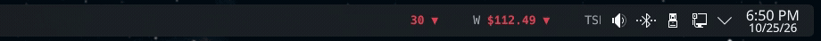

*On the panel at its default width and speed. [Watch it as video (MP4)](docs/screenshots/tape.mp4).*

**▶ [Watch the 2-minute demo](docs/demo.mp4)** — every tab, the detail view and the settings.

No account, no API key, no telemetry. Everything runs on your machine.

---

## What it does

### The tape

A scrolling strip on your panel: each symbol's price and a green ▲ or red ▼ for the day. **VIX turns red** at your fear line (20 by default). Hover pauses it and shows the full figures. Left-click opens the pop-up. Middle-click opens Yahoo Markets.

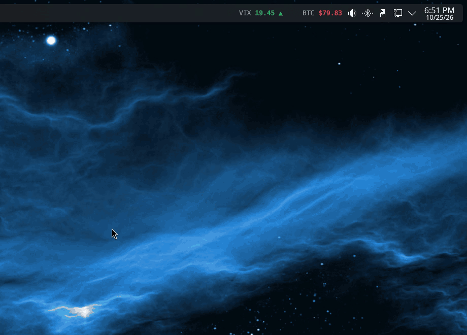

*Click the tape and the pop-up drops down from the panel. [Watch it as video (MP4)](docs/screenshots/popup.mp4).*

### Watchlist

Stocks, indices, ETFs, crypto, currencies and futures. Each has its price, the day's change and range, and an intraday sparkline. Star the ones you want on the tape.

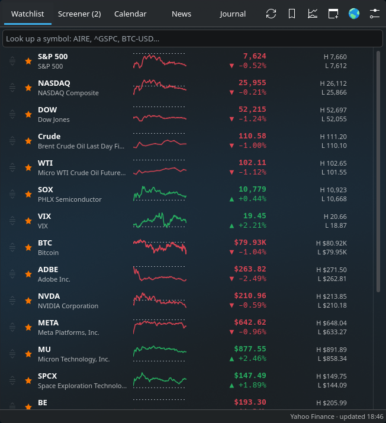

### Screener

About 4,000 actively traded US stocks, checked every 30 seconds. Five starting screens, all editable, and you can add your own:

| Screen | What it finds |
|---|---|
| **Running Up** | A stock up 3%+ off its low of the last 2 minutes, at a new high for that window |
| **High of Day** | A stock breaking the session's high |
| **Top Gainers / Top Losers** | The day's biggest movers, live |
| **Deep Value Recovery** | Companies worth $2B+ passing 6 or more of 8 long-term fundamental checks, price to free cash flow among them, at least 15% below their 52-week high and back above their 50-day average |

Each alert row carries float, short interest, relative volume, a **dilution rating** from SEC filings and a **scorecard**: your rules, scored live, with what was missed. Each screen can have its own alert sound.

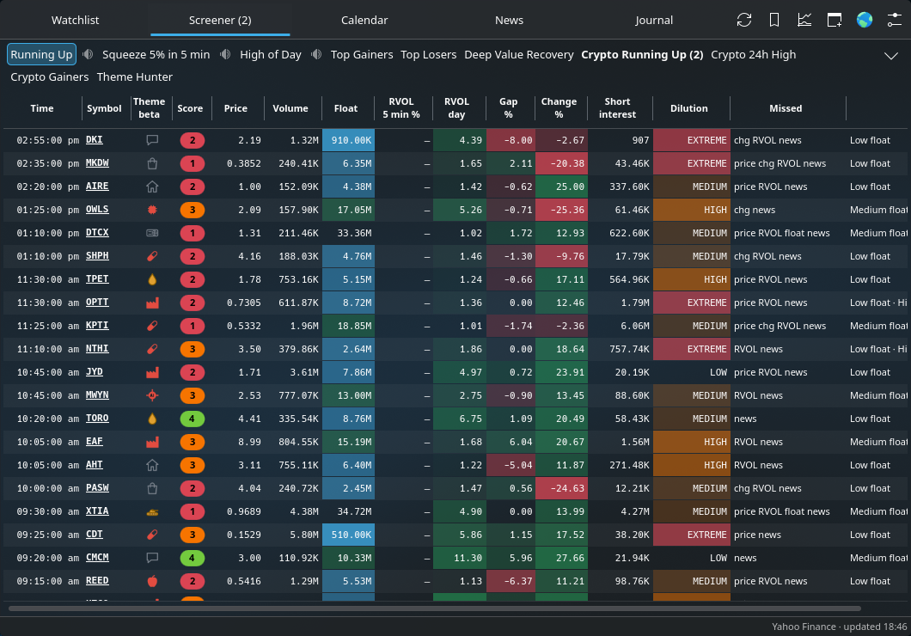

### Detail view

Click any symbol anywhere to get:
- **A chart.** Line or candles, 1D to 5Y, plus intraday 1m / 5m / 15m / 30m / 1h bars with premarket and after hours, VWAP and a volume strip.
- **Zoom and pan.** The scroll wheel zooms, dragging pans, and the price scale stretches.
- **Drawing tools.** Double-click for a price level, or use the Line button for trend lines. Both are saved per symbol.
- **Figures.** The full quote, float and short interest, and the dilution line.
- **The 8 long-term checks.** 5-year P/E, ROIC, share count, FCF / earnings / revenue growth, long-term liabilities to FCF, and price to FCF.
- **News** for that company.

| Chart and scorecard | Long-term checks and quote | Company news |
|---|---|---|
| 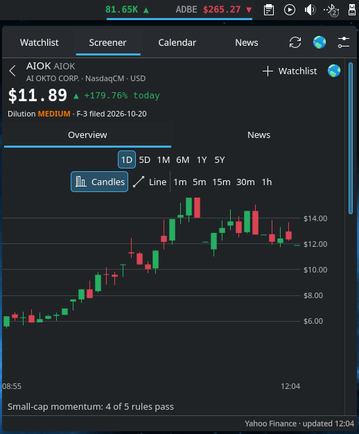 | 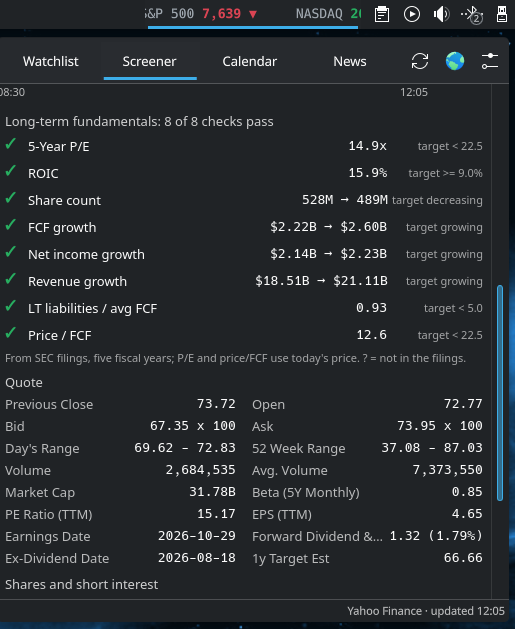 | 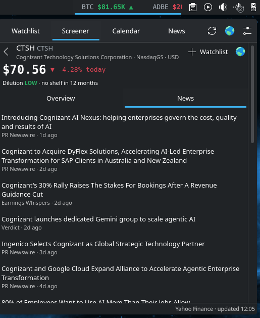 |

### Calendar and News

The week's market-moving economic releases (CPI, jobs, Fed, PMI and more) with expected, previous and actual figures. Earnings come with EPS estimates for **the companies you choose** (see [Settings → Data](#data)). The News tab carries the market desks plus headlines for every stock on your screens.

| Calendar | News |
|---|---|
| 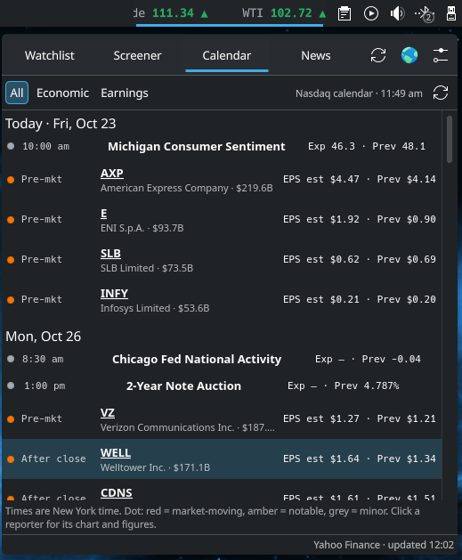 | 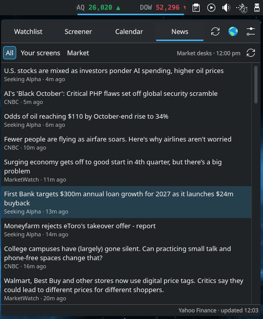 |

---

## Install

**You need:**
- KDE Plasma 6
- Python 3. Standard library only, nothing to `pip install`.
- PipeWire's `pw-play` for alert sounds. Optional; it is already there on most Plasma desktops.

```bash
git clone https://github.com/wolfe86/plasma-ticker-tape.git
cd plasma-ticker-tape
kpackagetool6 --type Plasma/Applet --install package
```

Then right-click the panel → **Add Widgets** → search **Plasma Ticker Tape** → drag it onto the panel.

**Update** after a `git pull`:

```bash
kpackagetool6 --type Plasma/Applet --upgrade package
systemctl --user restart plasma-plasmashell.service
```

**Remove:**

```bash
kpackagetool6 --type Plasma/Applet --remove org.wolfe.marketticker
```

### First run

| When | What happens |
|---|---|
| At once | The tape scrolls the starting symbols |
| ~30 s | The screener's stock pool is built and the first check runs |
| ~1 min | Top Gainers and Top Losers fill |
| ~1 min | The calendar loads |
| ~25 min | Deep Value Recovery has checked ~2,000 companies once. After that it checks each one once a day |

---

## Settings

Right-click the tape → **Configure Plasma Ticker Tape…**

| Page | What you set |
|---|---|
| **Symbols** | Your watchlist. Search to add, ★ to put on the tape, drag to reorder |
| **Screeners** | The stock pool, and every screen: type, trigger, filters, scorecard and sound |
| **Scorecards** | Named rule sets, for example *price $2–$20, up 10%+, relative volume 5×+, float under 20M, news today* |
| **Tape** | Scroll speed, width, refresh rate, the VIX fear line |
| **Data** | Where the data comes from, and which earnings you care about (below) |

| Symbols | Screeners | Scorecards |
|---|---|---|
| 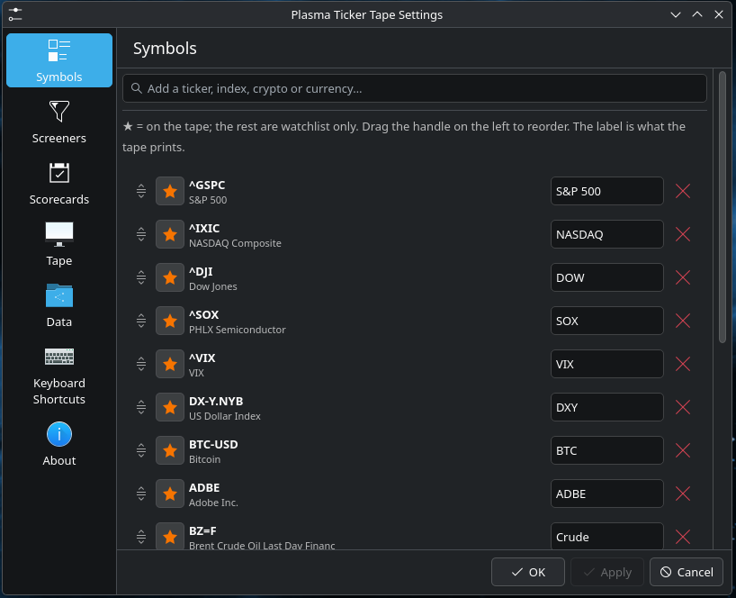 | 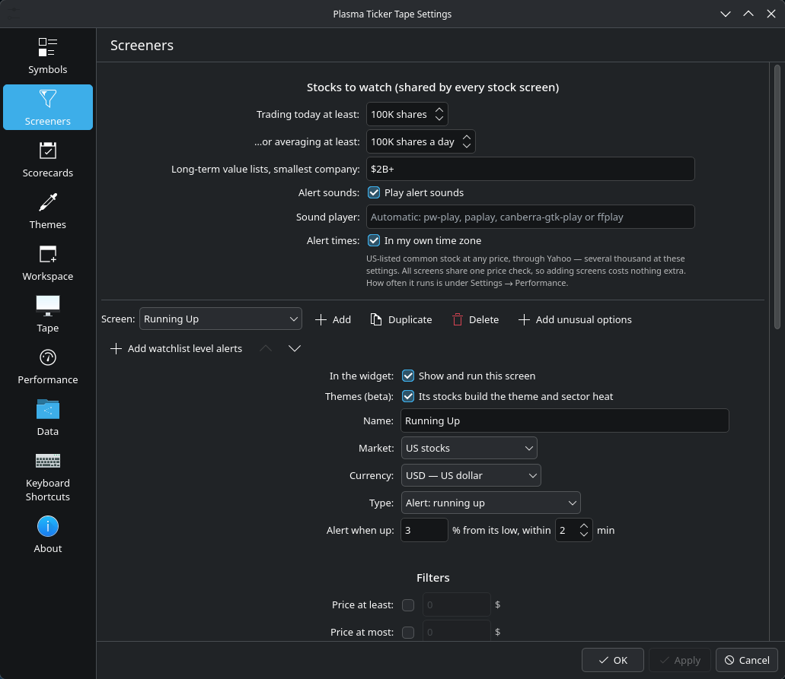 | 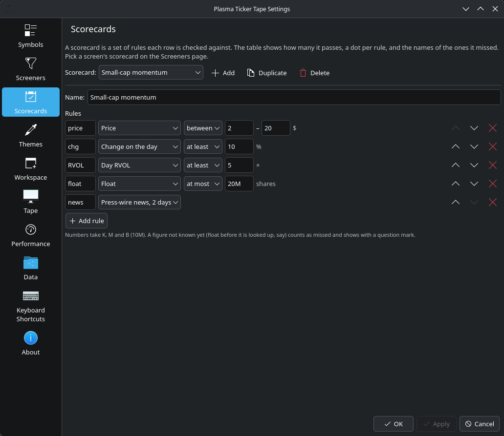 |

| Tape | About |
|---|---|
| 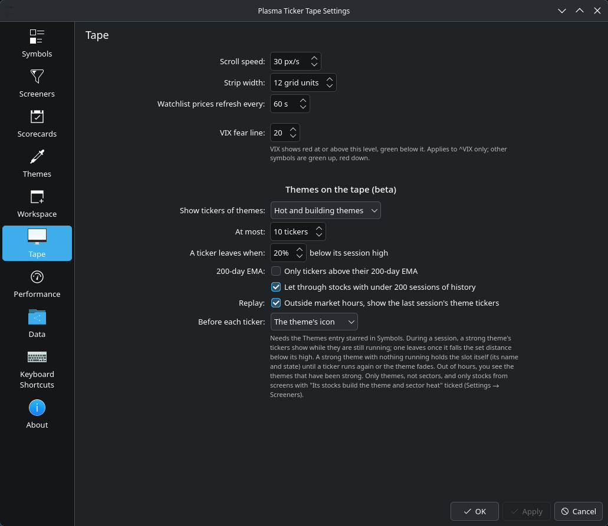 | 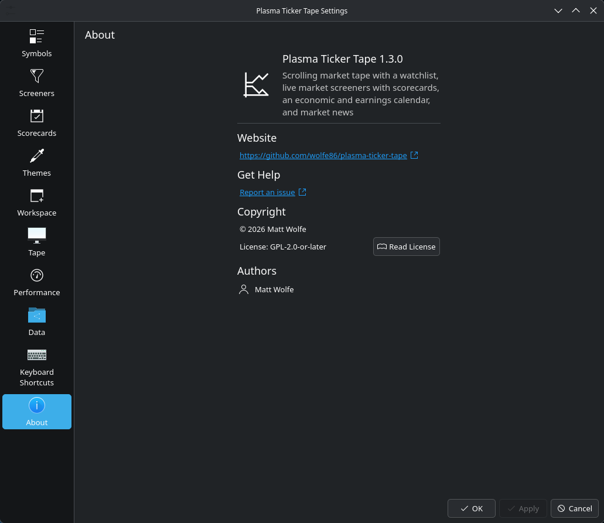 |

### Data

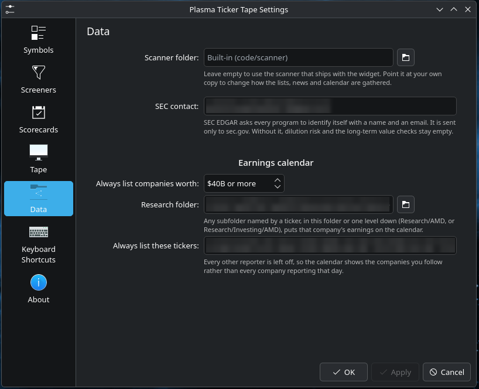

| Setting | What it does |
|---|---|
| **Scanner folder** | Leave empty to use the scanner that ships with the widget. To change how lists, news and the calendar are gathered, copy `package/contents/code/scanner/` anywhere, edit it, and point this at your copy |
| **SEC contact** | Your name and email, for example `Jane Doe jane@example.com`. SEC EDGAR requires every program to identify itself ([SEC fair access](https://www.sec.gov/os/accessing-edgar-data)). It is sent **only to sec.gov**. Leave it empty and the dilution rating and the 8 long-term checks stay off |
| **Always list companies worth** | Every company at least this big shows on the earnings calendar. Default $40B |
| **Research folder** | Optional. Any subfolder named by a ticker, in this folder or one level down, puts that company on the calendar. For example `Research/AMD` or `Research/Investing/AMD`. Handy if you keep notes per stock |
| **Always list these tickers** | Optional. Tickers you always want to see, separated by spaces or commas |

**Which earnings show up is up to you.** Every reporter that matches none of these three is left off, so the calendar shows the companies you follow instead of the hundreds that report each week. Set the floor to $0 to see every reporter.

---

## Where the data comes from

| Data | Source |
|---|---|
| Prices, charts, quotes, the screener's stock pool | Yahoo Finance (unofficial endpoints) |
| Premarket and after-hours gainers | stockanalysis.com |
| Float, short interest, relative volume, per-stock headlines | Finviz |
| Dilution (shelves, offerings) and the 8 fundamental checks | SEC EDGAR |
| Economic and earnings calendar | Nasdaq's public calendar |
| Market news | Seeking Alpha, MarketWatch and CNBC RSS feeds |
| Company names for news ranking | CNBC quotes |
| News for non-stock symbols | Google News RSS |

> [!WARNING]
> **These are not official data feeds.** Except for SEC EDGAR, none of these sources offers a documented public API for this use. They can change or stop answering without notice, and a screen or column will go empty until the scanner is updated. Quotes may be delayed. Check each site's terms for your own use. This project is not affiliated with any of them.

> [!CAUTION]
> **Not investment advice.** This is a tool for watching the market. Its screens, scores and ratings are mechanical filters, not recommendations.

---

## Privacy and security

- **Nothing is sent anywhere except the data sources above.** No telemetry, no accounts.
- **Your settings stay local.** They live in Plasma's config (`~/.config/plasma-org.kde.plasma.desktop-appletsrc`). The day's alerts, fundamentals results and your chart lines are kept in Qt's local database under `~/.local/share/plasmashell/QML/OfflineStorage/`. Downloads are cached in `~/.cache/market-ticker/`, capped at 200 MB.
- **The scanner runs as you.** The widget runs `python3` on the scanner folder you choose, so only point it at code you trust.
- **Settings are passed to the scanner as quoted environment variables**, never pasted into a command. Symbols from the data sources are checked against a strict pattern before they reach a shell.
- **Links from news feeds open only if they are web addresses** (`http://` or `https://`).

---

## How it is built

```
package/
├── metadata.json              the widget's name, version, licence
└── contents/
    ├── config/                every setting and its default; the settings pages
    ├── ui/                    QML: the tape, pop-up, screener engine, chart, calendar, news
    └── code/
        ├── scannerbridge.py   what the widget calls; prints one line of JSON
        └── scanner/           the data gathering: lists, Finviz, SEC, calendar, news
```

The tape and the screener talk to Yahoo directly from QML. Everything else goes through `scannerbridge.py`. You can run it by hand to see exactly what the widget gets:

```bash
python3 package/contents/code/scannerbridge.py "" calendar 3
MARKET_TICKER_SEC_CONTACT="Jane Doe jane@example.com" \
  python3 package/contents/code/scannerbridge.py "" value KO:62.5:
```

The `""` means the built-in scanner. Any failure prints `{"error": …}`, and the widget falls back or leaves that column empty.

### Troubleshooting

```bash
journalctl --user -b | grep -i marketticker
```

shows any errors from the widget.

---

## Licence

[GPL-2.0-or-later](LICENSE). © 2026 Matt Wolfe.
