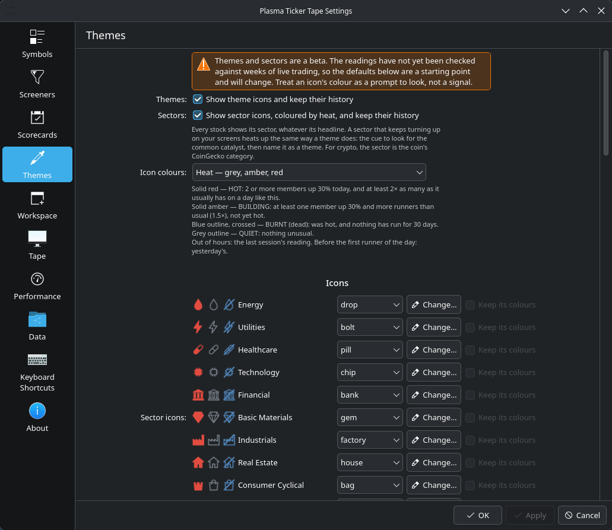

# Themes and sectors (beta)

A **theme** is an identifiable pattern among the stocks that run: AI headlines, oil and gas stocks on geopolitical fear, defense names on arms contracts, runners with no news at all, small foreign listings. Small caps tend to run one theme at a time, and a stock that runs with the theme of the week is more likely to hold attention and volume than one that pops on its own.

The widget puts each stock on the themes it fits, scores every theme **hot, building, quiet or burnt** from its record over the last few sessions, and shows the result on the screener, the quote card, the tape and the Theme Hunter.

A **sector** is the stock's industry group: Finviz's eleven sectors for stocks and CoinGecko's categories for crypto. Every stock has one. Sector icons are always grey, because a group the size of Healthcare has a +30% runner most days, so its heat says nothing.

Themes are set up in **Settings → Themes**. The starter set is there to edit, switch off or delete.

---

## 1. What a theme is made of

A theme is a set of conditions. A stock is on the theme when it meets them:

| Part | Field in Settings → Themes | How it is used |
|---|---|---|
| **Headline words** | the words box | The stock's newest headline contains one of them (see section 3). |
| **Industries** | *Or Finviz industries* | The stock is in one of these Finviz industries, headline or not. |
| **Traits** | the row of boxes under them | Every trait that is set must hold: news or no news in the last 24 hours, **Foreign** (based outside the US), **float** at or under a size, **listed** within a number of days (recent IPOs), **price** at or over / at or under, **market cap** at or under. |
| **Pins** | right-click a screener row | The ticker is on the theme from the day it was pinned. |

Words and industries say what the theme is about: when both are given, either will do. Traits narrow it, and all of them must hold. A theme can be traits alone.

A stock can be on several themes at once, for example an AI headline on a foreign micro-float. Its row shows the hottest of them.

### The starter themes

| Theme | Pattern |
|---|---|
| Crypto treasury | Headline words: a coin plus *treasury*, *holdings*, *acquires* and the like |
| Bitcoin miners | Headline words: *bitcoin mining*, *hashrate*, *exahash*… |
| AI | Headline words: *AI*, *GPU*, *inference*, *data center*, *LLM*… |
| Nuclear / SMR | Headline words: *SMR*, *reactor*, *uranium*… |
| Power & grid | Headline words: *megawatt*, *substation*, *fuel cell*… |
| Critical minerals | Headline words: *rare earth*, *antimony*, *lithium*… |
| Drones & defense | Headline words: *drone*, *munition*, *DoD*…, or the *Aerospace & Defense* industry |
| Space | Headline words: *satellite*, *orbital*, *lunar*… |
| Cannabis | Headline words: *cannabis*, *THC*, *psilocybin*… |
| No-news runners | Trait: no headline in the last 24 hours. Shown on a row only when that stock ran. |
| Foreign low-float | Traits: based outside the US, float 10M or under |
| Oil & gas | Industries: the six Finviz oil and gas industries |

---

## 2. Setting up a theme

1. Open **Settings → Themes** and click **Add a theme**.
2. Give it a name and pick an icon.
3. Fill in what it is about: headline words, Finviz industries, or both. Leave both empty for a theme of traits alone.
4. Set any traits: news, foreign, float, listing age, price, market cap. 0 means no limit.
5. Keep **Stocks** or switch to **Crypto**.
6. Tick the box at the start of the row so the theme is on, then **Apply**.

Past sessions are tagged again when you apply, from the headline, industry and figures saved for each stock that day.

---

## 3. Writing headline words

| Syntax | Matches | Example |
|---|---|---|
| `word` | the word as a whole word | `uranium` matches "uranium", not "uraniumite" |
| `word*` | any word starting with `word` | `drone*` matches "drone", "drones" |
| `a \| b` | either term | `eth \| sol` matches either |
| `a + b` | both terms within 60 characters | `treasury + bitcoin` |

Once a headline puts a stock on a theme, it stays on it for **10 sessions** (*Stays on a theme for*), so follow-up news that does not repeat the words still counts.

---

## 4. What counts as a runner

A theme's heat comes from its **runners**. A member is a runner on a day when:

- it was **up 30% or more** on the day at its best moment, premarket included (*A runner is up*), or **60% or more** if it had no headline in the last 24 hours (*…with no news*): 30% on nothing is ordinary for a small cap;
- on **5 times its usual volume** or more (*…on volume of*). A move on thin volume does not count. Before the open a stock's relative volume is often not known yet, and then it is not held against it.

The best moment counts, so a stock that ran 80% premarket and faded by 10:00 still ran: a premarket fade is still a tradeable pattern. The tooltip shows how much of their peak the runners kept at 10:00 and now.

Members come from the screens that **feed the themes**: Running Up, High of Day and Top Gainers by default. Change it per screen in **Settings → Screeners** (*Its stocks build the theme and sector heat*). Large caps count as members too: a group of large caps moving together is often what drives a small-cap theme.

A move over +200% counts only once the next check confirms it, so a single bad quote does not make a runner.

---

## 5. Reading the heat

A theme is established by its record, not by one morning:

| Status | Icon | What it means |
|---|---|---|
| **Hot** | solid red (heat colours) | Runners on **3 of the last 5 sessions**, more often than the theme usually has them. Once hot, it **stays hot** while runners keep turning up on at least 1 of the last 5. |
| **Building** | solid amber | A runner in the last 5 sessions, not yet hot. |
| **Quiet** | grey outline | No runner in the last 5 sessions. |
| **Burnt** | blue outline, crossed | It was hot, and nothing has run for **14 days**. |

"More often than usual" is measured against the theme's own record in the sessions before, once it has 10 sessions of history. It stops a broad pattern such as *no news*, which has a runner most weeks, from going hot every week. Until a theme has that history, the record alone decides.

Hover a theme icon for the reading: the record session by session with its best runners (★ marks a day the theme had the day's top gainer), today's members and runners, and how much of their peak the runners kept.

### The Runs column

**Runs 5 days** counts the sessions of the last five on which the stock itself ran, and the row's tooltip lists them: *"Ran on 2 of the last 5 sessions: +77% Mon 10-26, +144% Thu 10-23"*. A stock that keeps running is in play on its own, theme or not.

---

## 6. Theme Hunter

The **Theme Hunter** screen lists the themes and sectors with a reading, hottest first, with their members, and the **runners no theme claims yet**, grouped by sector. When several unclaimed runners share a headline or a trait, that is the next theme to set up.

---

## 7. The tape

Theme tickers reach the tape only when the **Themes** entry is starred in **Settings → Symbols** (the button **Add the Themes entry (beta)**). Then **Settings → Tape** controls the rest:

| Setting | Default | What it does |
|---|---|---|
| **Show tickers of themes** | Hot themes only | Choose **Hot and building themes** to include building ones. |
| **At most** | 10 tickers | The most theme tickers on the tape at once. |
| **A ticker leaves when** | 20% below its session high | A running stock drops off once it fades this far from its peak. |
| **Only tickers above their 200-day EMA** | on | Keeps only stocks trading above their 200-day average. |
| **Replay** | off | Outside market hours, show the last session's theme tickers. |
| **Before each ticker** | The theme's name | The theme's name, its icon, or both. |

---

## 8. The settings

Settings → Themes → **What counts as a theme**:

| Setting | Default |
|---|---|
| A runner is up | +30% on the day |
| …with no news | +60% on the day |
| …on volume of | 5× usual or more |
| Hot when runners on | 3 sessions |
| …of the last | 5 sessions |
| Stays hot on | 1 session with runners |
| …and beats its usual by | 1.5× |
| Dead after | 14 days with no runner |
| Stays on a theme for | 10 sessions after its headline |

Colours: a scheme for the icons (*Icon colours*: heat, market or violet), and a colour per theme if you want one.

---

## 9. Limits

- **Beta.** The rules and defaults will change as they are checked against weeks of live trading.
- **Only what was seen.** A stock counts only while it is on a screen that feeds the themes, and only while the widget is running. A day the widget was off is a day with no runners.
- **News is what the widget can read.** Headlines come from Finviz, and from Google News for a stock Finviz has no page for. A story that only appeared elsewhere (a filing, a post) is not seen, so some "no news" runners had news.
- **A history starts from install.** A new theme or rule re-scores the sessions already saved, but a theme of traits (foreign, float) can only be matched on days whose figures were saved, from 1.4 on.
- Themes are a way to notice patterns, not a recommendation to trade them.
