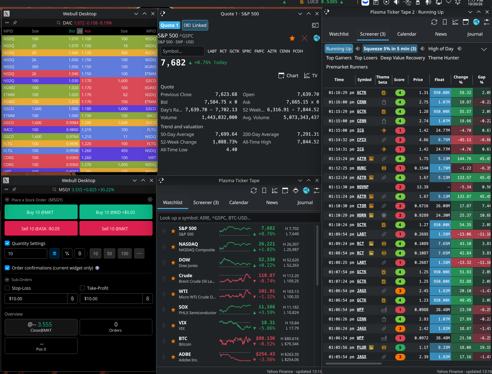
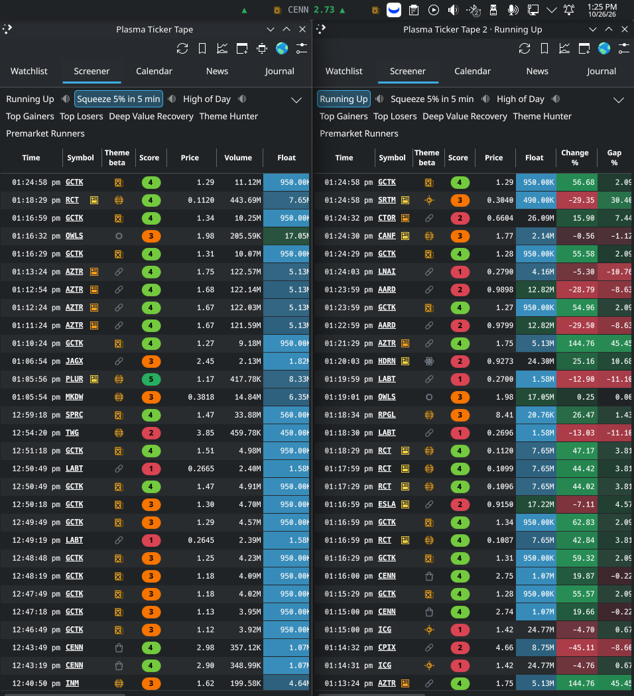
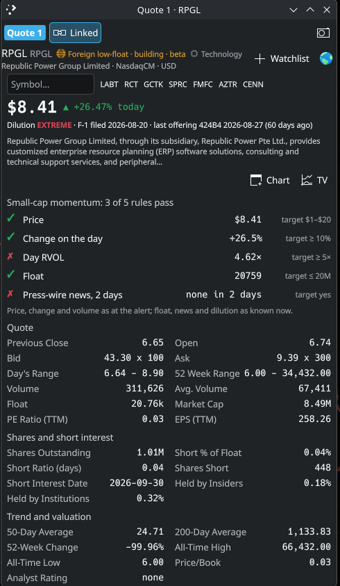
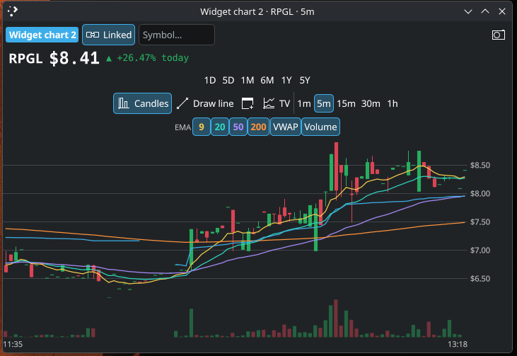
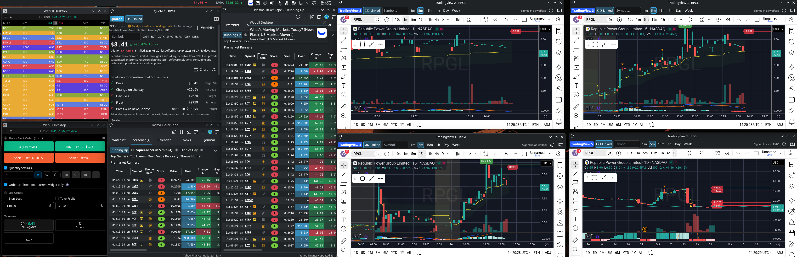
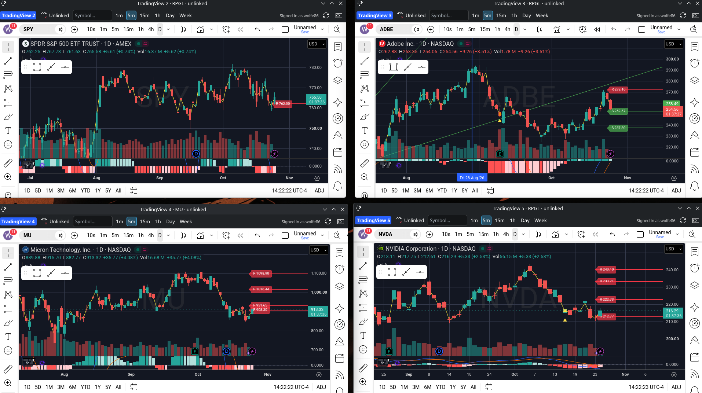
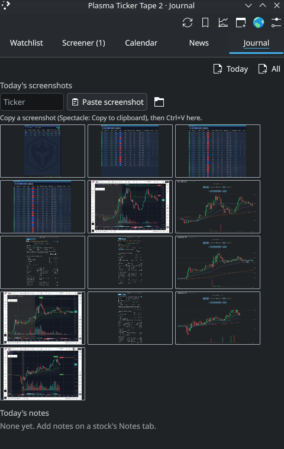

# The trading desk: windows, charts and the journal (beta)

The panel pop-up is fine for a glance. To keep the market on screen all session, pop everything out into windows: the scanners in one or several windows, a quote window, chart windows at the bar sizes you trade, and TradingView if you use it. Put your broker's Level 2 and order windows beside them.

> [!NOTE]
> **All of this is beta.** It is new in 1.3 and 1.4 and has had only days of real use. Report problems in the [issues](https://github.com/wolfe86/plasma-ticker-tape/issues).

They all work from **one active ticker**: click a ticker in any popped-out window and the quote window and every linked chart switch to it, while the list you clicked stays where it was.

*A desk on one monitor: the broker's windows at the left, then the quote window, the watchlist and a Running Up window, all popped out of the widget.*

| Two widget windows | The quote window | A chart window |
|---|---|---|
|  |  |  |

---

## 1. The windows

### Widget windows

The pop-out button in the pop-up's header (a window with a plus) opens the **detached window**: the pop-up's tabs in a window you can resize, tile and full-screen. **Dock back** (the restore button) closes it and opens the pop-up again.

Press the pop-out button again, in the pop-up or in any window, and **another window** opens on the tab and screen you were looking at. Each one is numbered (*Plasma Ticker Tape 2 · Running Up*) and keeps its own tab, its own screen on the Screener tab, and its own size. So Running Up can sit in one window, Crypto 24h High in a second and the calendar in a third. Close a window to get rid of it.

The pop-up and the detached window share one choice of screen; the extra windows each keep their own. In a narrow window the header's buttons sit on a row of their own above the tabs.

### The quote window

On a quote card, the **Quote** button (under the chart, at the right) pops the card out into the **quote window** and puts the pop-up back on its list. The quote window has everything on the card except the chart:

- the **Symbol…** box to look up any ticker, and the recent tickers beside it;
- **+ Watchlist**, or for a symbol already on the watchlist, a **star** (on the tape or not) and a **✕** (off the watchlist);
- the Overview, News and Notes tabs, the screen's scorecard (a card opened without a screen gets the first scorecard with live rules, Small-cap momentum to start) and every quote figure, float among them;
- a **camera** button that saves the card as shown (see [Screenshots](#4-screenshots));
- **Chart** and **TV** buttons, to open a chart window when none is open.

### Chart windows

The window button above a card's chart opens that chart in a window of its own, at the bar size on show; **TV** opens TradingView's chart instead. Open as many as you like, one per bar size: 1-minute, 5-minute and daily side by side.

Each chart window has its own bar-size buttons, a **Symbol…** box for that window alone, and a **camera** button that saves a screenshot (see [Screenshots](#4-screenshots)). The widget's own charts reload their bars every 30 seconds while on screen (Settings → Workspace). TradingView's stream live.

### TradingView windows

The TradingView button in the pop-up's header, or **TV** on a card or in the quote window, opens TradingView's chart page in a window, with its own indicators and drawing tools. You do not need an account. To use yours, **Settings → Data → Sign in to TradingView…** or the window's **Sign in** button opens TradingView's own sign-in page: the widget never sees or keeps your password. What data TradingView shows (real-time or delayed, which exchanges) depends on your TradingView plan.

TradingView windows need Qt WebEngine: `qt6-webengine` on Arch, `qml6-module-qtwebengine` on Debian and Ubuntu.

---

## 2. Linked and unlinked

Every chart window and the quote window is **Linked** or **Unlinked**, shown by the button beside its name.

- **Linked**: it follows the active ticker, the last one you opened anywhere.
- **Unlinked**: it keeps its own symbol. Typing a symbol in a chart window's own **Symbol…** box unlinks that window. Click the button again to link it back.

So you can watch four unlinked charts of four different tickers on one monitor while four linked charts at four bar sizes follow whatever you click on another.

| Linked: four TradingView bar sizes following one ticker | Unlinked: four tickers side by side |
|---|---|
|  |  |

### Where a click goes

| You click a ticker in… | What happens |
|---|---|
| Any popped-out window (the detached window or a widget window) | It opens in the quote window, made if none is open. Every linked window follows. The list stays put |
| The panel pop-up, with no linked quote window open | Its card opens in the pop-up, as before |
| The panel pop-up, with a linked quote window open | Same as a popped-out window. Turn this off in Settings → Workspace → *Quote window* |

A ticker counts wherever it is: a screener row, the watchlist, a headline's chip, a calendar reporter, a journal entry, or one typed into a **Symbol…** box.

---

## 3. Layouts, and putting windows back on their monitors

**Layouts** save a whole setup under a name: the screens on show, their columns and sorts, the mutes, the chart settings, and every open chart, quote and widget window. Use the bookmark button in the pop-up's header: **Save this layout…**, then pick the name later to switch back.

The windows reopen after a restart, but on Wayland a program cannot choose where its windows go, so KDE places them. To have each window come back in the same place:

1. Arrange the windows the way you want them.
2. Right-click a window's title bar → **More Actions** → **Configure Special Window Settings…**
3. Add **Position** and **Size**, and set both to **Remember**.
4. Repeat for each window.

This works because every window's title starts with a fixed name and number: *Plasma Ticker Tape 2*, *Quote 1*, *Widget chart 3*, *TradingView 2*. Do the same for your broker's windows and the whole desk comes back as you left it.

---

## 4. Screenshots

**From a chart or quote window.** Click the **camera** button. The chart, or the card as shown, is saved at once as a PNG in the screenshots folder, named by New York time, ticker and what it is, for example `2026-10-26_094107-312_JYD_tv-5m.png` or `…_CLRO_quote.png`. A folder button then appears beside it to open the folder. A quote window's shot is what is on screen: scroll first to the part you want.

**On the Journal tab.** Copy a screenshot (Spectacle → *Copy to clipboard*, or your broker's), then on the **Journal** tab press **Ctrl+V** or click **Paste screenshot**, docked or in a window. Type a ticker in the box beside it first to put the ticker in the file name. The tab shows every screenshot of the day from the folder as thumbnails, whichever window saved it; click one to open it.

**Into a note.** On a card's **Notes** tab, **Ctrl+V** in the note box or **Paste screenshot** adds the picture to the note; **Add note** saves the note with it.

All of them go to `screenshots/` in the export folder: `~/Documents/Plasma Ticker Tape/screenshots/` unless you set another folder in Settings → Workspace. Pasting needs `wl-clipboard` on Wayland (`sudo pacman -S wl-clipboard`, `sudo apt install wl-clipboard`) or `xclip` on X11. The camera button needs nothing extra.

---

## 5. The journal

**Notes.** Every card has a **Notes** tab: jot what you saw and why, and paste screenshots into it. The pop-up's **Journal** tab shows today's screenshots and today's notes.

**Export.** The Journal tab's export buttons save today, or everything, as Markdown in the export folder (`journal-2026-10-26.md`), with New York times, each note's screenshots under it, and the day's screenshots in a section of their own, ready for your trading journal.

The Options tab and option trades of 1.3 are switched off in 1.4: they were not ready.

---

## 6. The watchlist without Settings

On the Watchlist tab:

- **Drag** a row by the handle at its left to reorder the watchlist and the tape.
- Click a row's **star** to put it on the tape or take it off.
- Hover a row and click the **remove** button at its right end to take it off the watchlist.

The same star and remove buttons are on the quote card. These edits and **Settings → Symbols** change the same list, and each follows the other: if Settings is open while you edit in the pop-up, it picks the changes up, and merges them with any unsaved changes of its own.

---

## 7. Settings → Workspace

| Setting | What it does |
|---|---|
| **Light a screen's button for** | How long a screen's button glows in its colour after an alert |
| **Keyboard shortcut** | When on, the widget's shortcut (Settings → Keyboard Shortcuts) shows and hides the detached window instead of the pop-up |
| **Recent tickers kept** | How many recent tickers sit beside the **Symbol…** box (0 hides them) |
| **Quote window** | Whether clicks in the panel pop-up go to a linked quote window. Clicks in popped-out windows always do |
| **Company description** | How much of the company description a card shows |
| **Reload the bars every** | How often the widget's own charts reload while on screen |
| **Export** | The folder for alert CSVs, journal Markdown and screenshots |

---

## 8. Limits

- **Window placement** is KDE's on Wayland; use the window rules in [section 3](#3-layouts-and-putting-windows-back-on-their-monitors).
- **The widget's charts are not tick by tick**: they reload every 30 seconds by default (5 at the fastest). Use a TradingView window for a live chart.
- **TradingView is a web page** in a window: its terms apply, it sets its own cookies (kept in the widget's own web storage), and a change on TradingView's side can affect it.
- **Pasting screenshots** reads PNG pictures from the clipboard only, and needs `wl-clipboard` or `xclip`.
